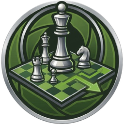
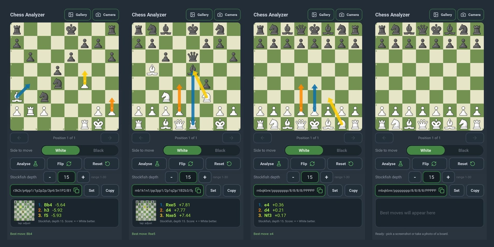
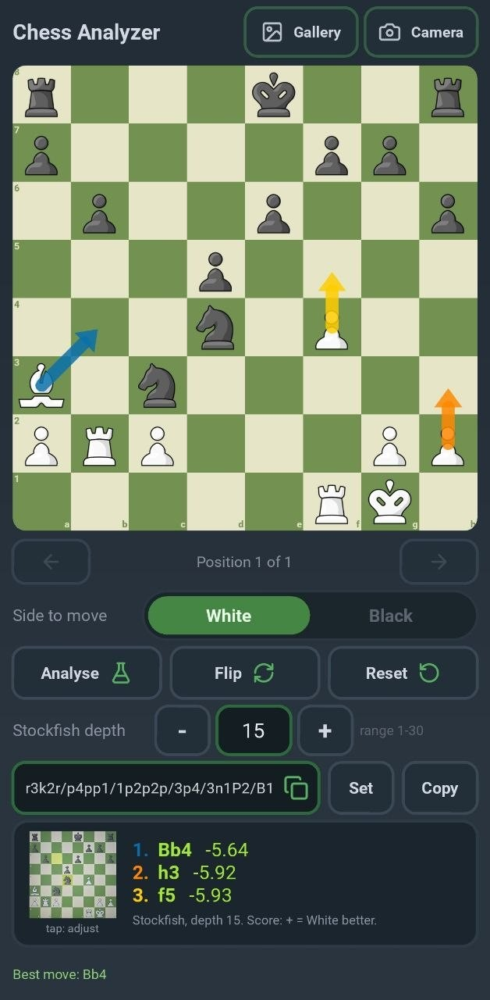
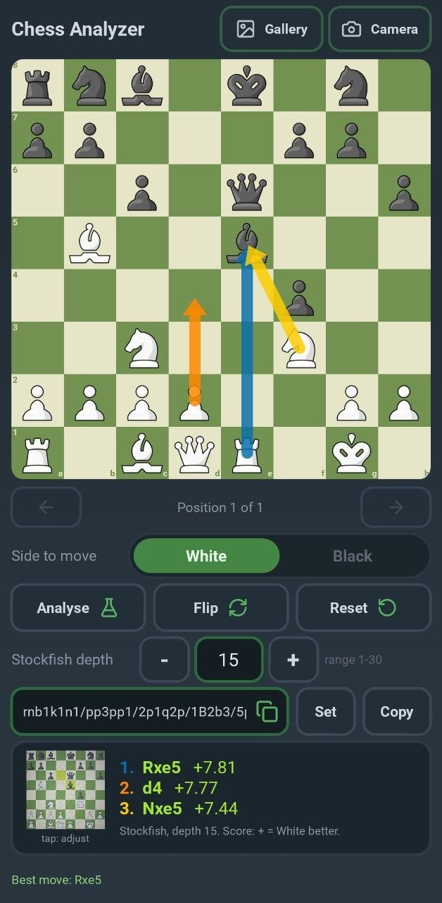
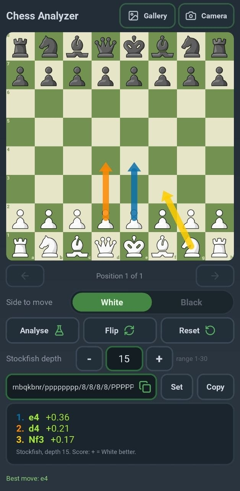
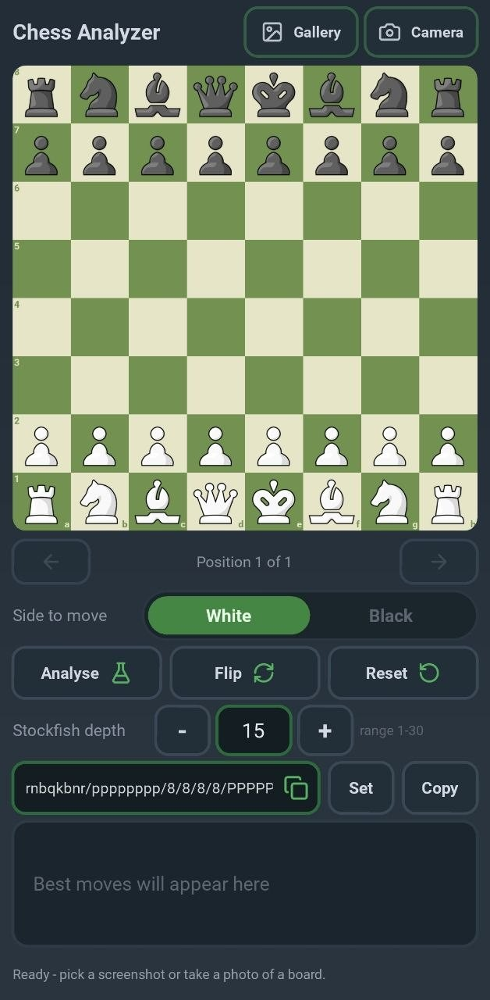
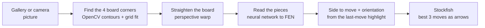

<p align="center">
  
</p>

<h1 align="center">Chess Analyzer for Android</h1>

<p align="center">
  Take a screenshot or a photo of a chess position and get the best moves.<br>
  The app finds the board, reads the pieces, works out whose turn it is and shows Stockfish's top&nbsp;3 moves as arrows.<br>
  It runs on your phone and works offline.
</p>

<p align="center">
  <a href="https://github.com/MhmdSyd/chess-detector-andoriod/releases/latest"></a>
  <a href="https://github.com/MhmdSyd/chess-detector-andoriod/actions/workflows/build.yml"></a>
  
  
  <a href="LICENSE"></a>
</p>

<p align="center">
  <a href="https://github.com/MhmdSyd/chess-detector-andoriod/releases/latest"><b>Download the APK</b></a> ·
  <a href="#how-it-works">How it works</a> ·
  <a href="#install-on-your-phone">Install</a> ·
  <a href="#using-the-app">Using the app</a> ·
  <a href="#build-the-apk-yourself">Build it yourself</a>
</p>

<p align="center">
  
</p>

---

## What is this?

**Chess Analyzer** is an Android app (an APK, written in Python with [Kivy](https://kivy.org)) that answers one question:
*"What should be played in this position?"*

You give it a picture of a chess board, for example a screenshot from a chess app or a photo of a screen.
It does the rest on the phone:

1. finds the four corners of the board and straightens it, even when the photo is a bit tilted;
2. reads every piece with a neural network and builds the position (**FEN**);
3. works out whose turn it is and which side is at the bottom;
4. asks **Stockfish** for the three best moves and draws them on an interactive board.

It is an Android port of a desktop Python/Tk tool ("Full Chess Detector"). The desktop version used TensorFlow, OpenCV and Tkinter,
which cannot run on a phone, so the board reading, board finding and interface were rebuilt for Android.

## Features

**Reading a picture**
- Pick a picture from the **gallery** or take one with the **camera**. Everything then happens automatically.
- **Board detection with OpenCV contours**, checked against the 8x8 checkerboard pattern so that panels or the phone frame are not mistaken for the board.
- **Perspective correction**: a rotated or tilted photo is warped into an upright square before the pieces are read.
- **4-corner editor** with a magnifier for the rare photo that needs a manual fix (tap the small board preview).
- Detects the **board orientation** (White or Black at the bottom) and the **last move** from the highlighted squares to find the side to move.
- A safety net: if the guessed side to move would leave the other king in check, the turn is corrected automatically.

**Analysis**
- **Stockfish 17.1 is built into the app**, so it works without internet.
- **Top 3 moves** with scores (`+0.36` means White is ahead by about a third of a pawn, `M3` means White mates in 3). Arrows: blue = best, orange = second, yellow = third.
- **Adjustable depth (1-30)** with - / + buttons or by typing a number. The setting is remembered.
- If the engine cannot start, the app falls back to Lichess cloud analysis (needs internet; only knows common positions).

**The board**
- Interactive: tap a piece, then one of the dotted squares. Pawns promote to a queen automatically.
- **Back / forward arrows** step through the positions you have played; going back and playing something else starts a new line.
- **Side to move**, **Flip**, **Reset**, and a **FEN box** (edit and press *Set*, or copy the FEN with *Copy*).
- A fixed **one-screen layout** that fits phones from small to large, with no scrolling.

## Screenshots

<table>
  <tr>
    <td align="center" width="25%"></td>
    <td align="center" width="25%"></td>
    <td align="center" width="25%"></td>
    <td align="center" width="25%"></td>
  </tr>
  <tr>
    <td align="center"><sub><b>Read from a photo.</b> The straightened board is shown in the card; Stockfish suggests <code>Bb4</code>, <code>h3</code>, <code>f5</code>.</sub></td>
    <td align="center"><sub><b>Finding the tactic.</b> <code>Rxe5</code> is best, drawn as the blue arrow.</sub></td>
    <td align="center"><sub><b>Starting position.</b> <code>e4</code>, <code>d4</code>, <code>Nf3</code> at depth 15.</sub></td>
    <td align="center"><sub><b>Ready.</b> Pick a screenshot or take a photo of a board.</sub></td>
  </tr>
</table>

## How it works



| Step | What happens | Where in the code |
|---|---|---|
| Find the board | Many candidate four-corner shapes are collected (OpenCV contours, plus a NumPy checkerboard finder). Each one is fine-tuned so an 8x8 grid fits exactly, and the best fit wins. | `board_detect.py`, `board_finder.py` |
| Straighten | The winning four corners are warped into an upright square. | `board_detect.py` |
| Read the pieces | The 64 squares are classified by the same small CNN as the desktop tool. Its weights were exported to a file and the network runs in plain NumPy, so no TensorFlow is needed on the phone. | `fen_model.py`, `assets/piece_model.npz` |
| Turn and orientation | Highlighted last-move squares tell who moved last. Without a highlight the app assumes you want advice for the side at the bottom. | `chess_utils.py` |
| Best moves | The Stockfish binary is shipped inside the APK and talked to over UCI. A newer request always cancels an older one. | `engine.py` |

## Install on your phone

1. Open the [**latest release**](https://github.com/MhmdSyd/chess-detector-andoriod/releases/latest) on your phone and download the `.apk` file.
2. Open the downloaded file. If Android asks, allow **Install unknown apps** for your browser or file manager.
3. Open **Chess Analyzer**. The first time you use **Camera**, allow camera access.

> **"App not installed" when updating?** Builds made on GitHub are signed with a temporary key, so Android may refuse to install a new build over an older one. Uninstall the old version first, then install the new one.

**Requirements:** Android 10 or newer on a 64-bit ARM phone (most phones from the last several years).

## Using the app

| Control | What it does |
|---|---|
| **Gallery** | Choose a screenshot or photo. The app finds the board, reads it and analyses it automatically. |
| **Camera** | Take a photo of a board (for example on another screen). |
| **Board** | Tap a piece, then a dotted square, to play a move. Blue, orange and yellow arrows are Stockfish's 1st, 2nd and 3rd choice. |
| **Back / forward arrows** | Step through the positions you played. The caption shows `Position 3 of 7`. |
| **Side to move** | Choose White or Black. The best moves are recalculated for that side. |
| **Analyse** | Run Stockfish again on the current position. |
| **Flip** | Turn the board around to view it from Black's side. |
| **Reset** | Go back to the starting position. |
| **Stockfish depth** | How deep the engine thinks (1-30). Higher is stronger but slower, especially on a phone. 15 is a good default. |
| **FEN box, Set, Copy** | Shows the current position. Edit it and press **Set** (or Enter) to load a position, or **Copy** to copy it. |
| **Result card** | The best three moves and a small preview of the board the app read. Tap the preview to adjust the corners by hand. |

### Tips for the best result

- Use a **straight screenshot** if you can. For photos, fill the frame with the board and avoid glare.
- Make sure the **whole board** is in the picture, including all four corners.
- If the position looks wrong, tap the small board preview, drag the four yellow corners onto the corners of the board and press **Analyse**.
- If the best moves are for the wrong side, change **Side to move**.

### Limitations

- Made for **digital boards** (screenshots, or photos of a screen). It is not meant for physical 3D boards.
- The piece reader works best with common flat 2D piece sets. Blurry, very small or very artistic pieces can be misread.
- Rotation and moderate tilt are corrected. Very steep angles, or a board that is partly cut off, may need manual corners.
- The last move is detected from a blue/teal highlight. Without it the app assumes the side at the bottom is to move, so check **Side to move**.
- Castling rights are guessed from the king and rook positions. En passant is not detected.
- The Lichess fallback only knows common positions.

## Privacy and permissions

- **Pictures never leave your phone.** All board finding and reading happens on the device.
- `CAMERA` is used only when you press **Camera**. `INTERNET` is used only for the Lichess fallback, and then **only the position text (FEN)** is sent, never a picture.

## Build the APK yourself

### With GitHub Actions (no setup on your computer)

1. Fork this repository (or upload the files to your own).
2. Open **Actions → Build APK → Run workflow**.
3. Keep **Include OpenCV** ticked (default). Untick it only if the build fails because of OpenCV; the app then falls back to its NumPy board finder, which copes less well with tilted photos.
4. Wait for the run to finish. The first build takes a long time (over an hour is normal); later builds are quicker because downloads are cached.
5. Open the finished run and download the **ChessAnalyzer-apk** artifact. Unzip it to get the `.apk`.

The workflow downloads the Stockfish 17.1 Android binary and bundles it as `libstockfish.so`.

### Locally (Linux or Windows WSL)

```bash
pip install buildozer cython
sh scripts/fetch_stockfish.sh      # puts Stockfish into libs/arm64-v8a/
buildozer android debug            # the APK appears in ./bin
```

### Run on a PC (for development)

```bash
pip install -r requirements-desktop.txt     # kivy, numpy, pillow, chess
pip install opencv-python-headless          # optional, adds the contour detector
python main.py                              # opens a phone-sized window
python main.py screenshot.png               # load a picture straight away
CHESS_WIN=360x780 python main.py            # try another phone size
```

You need [Stockfish](https://stockfishchess.org/download/) on your `PATH` (or set `STOCKFISH_PATH`).

### Tests

The tests live in `tests/` and use generated chess pictures (rotated, tilted, blurred, noisy). Extra packages:
`pip install chess cairosvg opencv-python-headless tensorflow chess-fen-detector scikit-image`.

| Test | Checks |
|---|---|
| `test_model_parity.py` | The NumPy network gives the same answers as the original Keras model. |
| `test_chess_logic.py` | HSV conversion, orientation, last-move detection, Stockfish scores. |
| `test_quad.py`, `stress_quad.py` | Board corner detection and straightening on distorted photos. |
| `ui_interaction.py` | Touch input, back/forward history, FEN box, depth control, corner editor (headless). |
| `ui_layout.py` | Everything fits on one screen at several phone sizes. |
| `ui_smoke.py` | The automatic picture-to-best-moves flow. |

The UI tests run headless with `xvfb-run -a python tests/ui_interaction.py`.

## Project structure

```
main.py             app screens and the picture -> position -> analysis flow
theme.py            colours and custom widgets (rounded buttons, the White/Black switch)
board_widget.py     the interactive board (pieces, arrows, last move)
crop_view.py        4-corner board editor with magnifier
board_detect.py     board corner detection (contours + grid fit) and perspective warp
board_finder.py     NumPy checkerboard finder (fallback / helper)
fen_model.py        piece-recognition network in NumPy
chess_utils.py      FEN helpers, orientation, last-move detection
engine.py           Stockfish over UCI, Lichess fallback
android_utils.py    gallery and camera
assets/             piece_model.npz, piece images, icons, app icon and logo
scripts/            fetch_stockfish.sh
tools/              export_weights.py (how the model weights were exported)
tests/              automated tests
.github/workflows/  the APK build
```

## Third-party components

| Component | Used for | Licence |
|---|---|---|
| [Stockfish](https://github.com/official-stockfish/Stockfish) 17.1 | The chess engine bundled in the APK | GPL-3.0 |
| [python-chess](https://github.com/niklasf/python-chess) | Rules, legal moves, FEN | GPL-3.0+ |
| [chess-fen-detector](https://pypi.org/project/chess-fen-detector/) | The piece-recognition network (weights exported to NumPy) | MIT |
| [Kivy](https://kivy.org), [python-for-android](https://github.com/kivy/python-for-android), [Buildozer](https://github.com/kivy/buildozer) | App framework and Android packaging | MIT |
| [OpenCV](https://opencv.org) | Contour-based board detection | Apache-2.0 |
| [NumPy](https://numpy.org), [Pillow](https://python-pillow.org) | Maths and image handling | BSD / HPND |
| [Lucide](https://lucide.dev) | Button icons (`assets/icons`) | ISC |
| [Lichess cloud evaluation](https://lichess.org/api#tag/Analysis) | Optional online fallback | free public API |

The chess piece images in `assets/pieces` were supplied by the project owner. Check their licence before redistributing the app.

Because Stockfish and python-chess are GPL-3.0, this project is released under the **GPL-3.0** (see [LICENSE](LICENSE)).
The Stockfish source code is available from the link above.

## Fair play

This app is meant for **analysis, study and practice**. Using engine help during live games against other people breaks the fair-play rules of chess.com, Lichess and FIDE. Please do not do that.

## Changelog

See [CHANGELOG.md](CHANGELOG.md).
