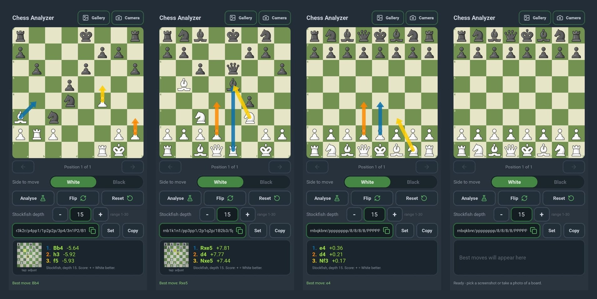

## Chess Analyzer 1.6

**One-screen layout, a tidier header, and an adjustable Stockfish depth.**

  

### What's new in 1.6

- **Fits every screen, no scrolling.** The whole app is on one fixed screen. The board uses the free space, and small phones automatically get a compact layout.
- **Cleaner header and rows.** "Chess Analyzer" stays on one line, the buttons are shorter, and the FEN box is a single line.
- **Stockfish depth setting.** New *Stockfish depth* control (1-30): use - / + or type a number. Your choice is remembered. A higher depth is stronger but slower, especially on a phone.

### What the app does

- Choose a screenshot or take a photo. The app finds the board, straightens it, reads the position (FEN), works out whose turn it is and shows Stockfish's **top 3 moves** as arrows.
- Handles tilted or rotated photos (perspective correction). A 4-corner editor is there if a photo needs a manual fix.
- Interactive board with **back / forward arrows**, flip, reset, and FEN copy / set.
- Works **offline** with the built-in Stockfish 17.1 (Lichess cloud analysis is used as a fallback).

### Install

1. Download **ChessAnalyzer-v1.6-arm64.apk** from the *Assets* list below.
2. Open it on your phone. If asked, allow **Install unknown apps** for your browser or file manager.
3. Open **Chess Analyzer**. The first time you use **Camera**, allow camera access.

If Android says **"App not installed"** when updating from an older build, uninstall the old version first and install again.

### Requirements

- Android 10 or newer
- A 64-bit ARM phone (most phones from the last several years)

### Known limitations

- Made for digital boards (screenshots, or photos of a screen), not physical 3D boards.
- The whole board must be visible. Very steep camera angles may need manual corners.
- The side to move is read from the highlighted last move (blue/teal). Without it, check **Side to move**.

### Checksum

SHA-256: `paste the value here`

**Full changelog:** [CHANGELOG.md](https://github.com/MhmdSyd/chess-detector-andoriod/blob/main/CHANGELOG.md)
